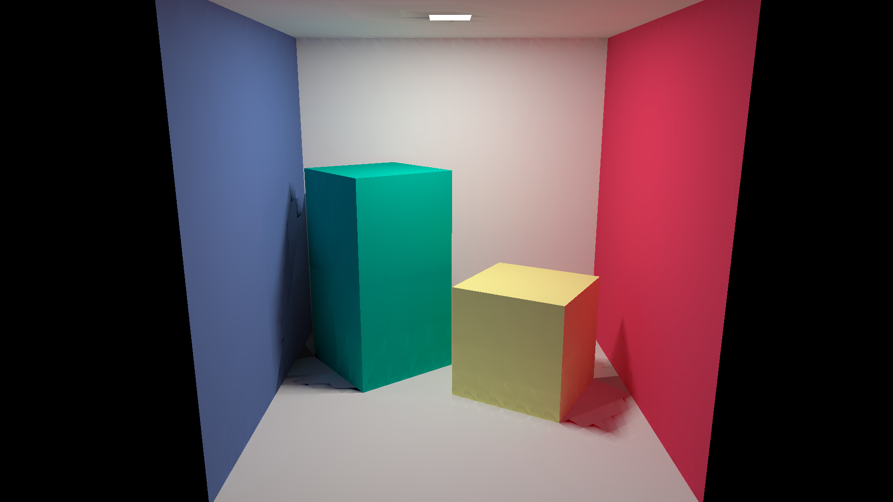
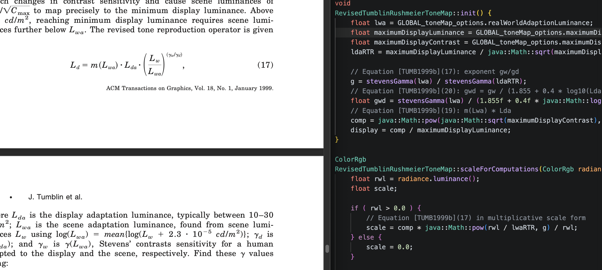

# rpkCpp
Modernized version of RenderPark radiosity engine.

Original software from 2001 is available on
[https://graphics.cs.kuleuven.be/renderpark/](https://graphics.cs.kuleuven.be/renderpark/).

## C++ specific notes

The C++ modernization checklist and architecture notes are now in
[cpp/README.md](./cpp/README.md).

## Java app notes

The Java 17 Gradle app notes are in
[java/README.md](./java/README.md).

## What RPK program does

Basically, this program has two use cases:
- Galerkin / geometric subdivision view independent solution.
- Raytracer solution: Check the use of `RAYTRACING_ENABLED` macro on how to remove this code from project.

The program is a command line application that reads a geometry description in [MGF file format](./doc/references/mgfFileFormatSpecs/), computes the 3D image and writes the resulting image in ppm format (note that Galerkin geometry is also exported in VRML). For example, [this scene](./etc/cube.mgf) is rendered as the classic Cornell Box:



## Annotated math in code with respect to references

Papers to understand the code are included in [doc/references](./doc/references). Where identified, key equations in code are annotated with citations to original papers or book chapters.

Here is an example:


## Install prerequisites

### On linux

```bash
apt-get install cmake build-essential freeglut3-dev libglu1-mesa-dev libosmesa6-dev imagemagick
```

### On MacOS

```bash
brew install mesa cmake
```

## Build program

```bash
mkdir build
cd build
cmake ..
make
cd ..
```

Generated images will be written at `./output` folder, reading models from `./etc`.

## Optional OpenGL/GLUT support

OpenGL support is controlled from CMake with `OPEN_GL_ENABLED` (default: `ON`).

- If `OPEN_GL_ENABLED=OFF`, OpenGL-dependent modules are not compiled and not linked into `rpk`.
- If `OPEN_GL_ENABLED=ON` but required OpenGL/GLUT libraries are not found, CMake automatically disables OpenGL support for that build.
- The runtime debug window option `-glutDebug` requires OpenGL support.

Examples:

```bash
# Build with OpenGL/GLUT support (default)
cmake -S . -B build -DOPEN_GL_ENABLED=ON
cmake --build build -j
```

```bash
# Build without OpenGL/GLUT support
cmake -S . -B build -DOPEN_GL_ENABLED=OFF
cmake --build build -j
```

If a binary compiled without OpenGL support is run with `-glutDebug`, the program exits with an error message asking to recompile with `-DOPEN_GL_ENABLED=ON`.

## Selecting the scene index (C++ port)

The C++ port answers every visibility and ray-casting query of the scene through one scene query, whose spatial index is chosen with `-scene-acceleration`:

- `wald2007` (default): VITRAL's binned SAH hierarchy (`BinnedSahSpatialIndex`).
- `voxel`: VITRAL's port of RenderPark's hierarchical voxel grid (`GridSpatialIndex`, after Snyder and Barr 1987, `doc/references/[SNYD1987]_*.pdf`).
- `bruteforce`: every face tested, as a reference.

RenderPark's original voxel grid (`VoxelGrid`, option `legacy`) was retired from the C++ port in step 6 of the alignment plan: `wald2007` is 32 % faster on the corridor, and `voxel` gives the same answers. The Java, TypeScript and Turbo C++ ports still have `legacy` until they are synchronized.

Every index only prunes; RenderPark's exact face test decides each hit, so with a given shaft culling mode the images are the same with every choice (see `doc/vitralAlignmentPlan.md`, step 5). The one exception seen is a face-index tie: two eye rays of scene 13 (out of 547 million queries) hit the shared edge of two faces at exactly the same distance, and `wald2007` picks the other face, which moves one pixel by one unit.

## Shaft culling off by default (Galerkin)

RenderPark's Galerkin radiosity culls the candidate occluders of each interaction with a shaft (`-gr-shaft-culling refinement`, RenderPark's default), so that a shadow ray is tested against a short list instead of the whole scene. With a fast scene index this no longer pays: building a candidate list per interaction costs more than sending every shadow ray to the whole-scene query, which the WALD2007 hierarchy answers in logarithmic time. Measured on the C++ port (CPU time, `/usr/bin/time`, 2026-11-21):

| Scene | `wald2007` + shaft culling | `wald2007`, no shaft culling | Change |
| --- | --- | --- | --- |
| 08 soda (11 iterations) | 3079 s, 4.8 GB | 1249 s, 4.7 GB | 2.5x faster |
| 02 corridor | 245 s | 202 s | -18 % |

Without shaft culling more shadow rays are traced (soda: 1.53 against 1.40 billion), but each one is cheap. The default is therefore `-scene-acceleration wald2007` with `-gr-shaft-culling never`, in all four ports; `-gr-shaft-culling refinement` (or `always`) gives back RenderPark's original method (with `-scene-acceleration voxel` for its grid traversal; `legacy` in the ports that still have it).

The results are not bit-identical to the original method. In the `refinement` mode the shaft also enters the error estimate that decides which interactions are refined, so the element and interaction counts differ slightly from the first iteration on (soda after 11 iterations: 320,451 against 321,619 elements, 21,928,099 against 21,938,082 interactions), and so do the images: for soda, 8,925 of 2,073,600 pixels differ, RMSE 0.00015 (normalized). The golden images (then in `doc/testBaseImages`) and the C++ references were captured again with the new default (2026-11-21), so the golden tests check the new method from now on; the other ports record their bounds against them when they are synchronized. The corpus entries `16_cubeJacobiNoShaftCulling` and `18_corridorNoShaftCulling`, which ran the cube and the corridor with `-gr-shaft-culling never`, were removed: with the new default they repeat `01_cubeJacobi` and `02_corridor` (identical images in all four ports). The corpus has therefore no scene with shaft culling; the mode stays available through the option. Shaft culling still pays in small scenes refined very finely: the cube of `21_tonemapWard` takes 33 s with `refinement` and 129 s with `never` (C++, CPU time), because the shaft spares 186 million of its 298 million shadow rays.


## Selecting Niederreiter variant (31-bit vs 63-bit)

The quasi-Monte-Carlo Niederreiter implementation provides:

- A generic API in `Niederreiter.h`: `Nied`, `NextNiedInRange`, `radicalInverse`, `foldSample`.
- Explicit APIs per variant:
  - 31-bit: `niederreiter31`, `NextNiedInRange31`, `radicalInverse31`, `foldSample31`
  - 63-bit: `Nied63`, `NextNiedInRange63`, `radicalInverse63`, `foldSample63`

Variant selection for the generic API is compile-time:

- Default build (without `NOINT64`): uses 63-bit variant.
- Build with `NOINT64` defined: uses 31-bit variant.

Examples:

```bash
# 63-bit (default)
cmake -S . -B build
cmake --build build -j
```

```bash
# 31-bit (force by disabling 64-bit Niederreiter generic API)
cmake -S . -B build -DCMAKE_CXX_FLAGS="-DNOINT64"
cmake --build build -j
```

Note: modules calling explicit `*31`/`*63` functions keep using that exact variant by design.

## Running RPK program from the command line

The following command will run all the samples located on the `./etc` folder and generate output
files on `./output` folder.

```bash
./scripts/runAll.sh
```

`runAll.sh` runs the same test corpus as `runCorpus.sh`, with the same outputs and logs, so its results
can be checked with `testReviewResults.sh`. The difference is that it starts the runs in the background
and returns at once, and the runs go on after the terminal is closed. With no arguments it also runs
`08_runSoda.sh`, which is not part of the corpus; with arguments it runs only the corpus entries they name.
`output/runCorpus.log` ends with the line `runCorpus.sh exit status: N` when every corpus run has finished.
The script is the same in every port.

For parallel Jacobi, `scripts/runAllParallel.sh` in the C++, Java and TypeScript
ports accepts `--threads N` and an optional `--cpu-groups` argument. CPU groups
are semicolon-separated Linux `taskset` CPU lists; successive scene processes
are assigned to the groups in round-robin order, and their children inherit the
affinity. For example, on a machine whose two sockets use CPUs 0–17 and 18–35:

```bash
./scripts/runAllParallel.sh --threads 18 --cpu-groups '0-17;18-35'
```

The script starts multiple scenes concurrently. The thread count is per scene,
not a global limit. Affinity needs `taskset` and `flock`; omit `--cpu-groups`
to leave affinity unchanged. The actual CPU numbers depend on the machine.
Positional image or script names after the options select corpus entries.

To check a change, run the test corpus and then the image gate (ImageMagick `compare`):

```bash
./scripts/runCorpus.sh                   # whole corpus in parallel, or name images to run a subset
./scripts/testReviewResults.sh           # C++: every output pixel-identical to its golden image in etc/goldenImagesForTests
```

Failed comparisons leave difference images in `./output/diff`. The Java, TypeScript and Turbo C ports
keep their own references in `<port>/etc/goldenImagesForTests` (`--exact`, with statistics fingerprints)
and compare against the C++ golden images within recorded RMSE bounds (`--golden`).

### Rebuilding the C++ golden images

`cpp/etc/goldenImagesForTests` holds only the golden images, `<image>.ppm`, one per corpus output; they
are versioned and they are the golden images of every port. On 2026-11-26 they replaced the former
`doc/testBaseImages` set, captured again after the C++ port moved to double precision and two Galerkin
fixes (links appended during an element's own refinement are no longer refined in the same pass, and the
point-to-area form factor of the higher order cubature is bounded by 1), which removed the bright spots
of `03_hospital` and `04_office1`. Rebuild them, from `cpp/`, only by decision of the project owner, on a
tree whose outputs you trust:

```bash
./scripts/compile.sh
./scripts/runCorpus.sh
./scripts/testReviewResults.sh --capture-references   # copies output/<image>.ppm to etc/goldenImagesForTests
```

The command accepts image or script names to rebuild only part of the set.

## Running program on old hardware

Newer compilers uses specific machine instructions that are available only on newest hardware
(i.e. AVX512). If running the `rpk` executable is giving error, disable the generation of
such optimizations by removing the following line on `CMakeLists.txt`:

```bash
add_compile_options(-O3)
```

Floating point is IEEE 754 in every build: each `CMakeLists.txt` adds `-fno-fast-math -ffp-contract=off`
(GCC and Clang) and none enables `-ffast-math`. Under fast-math the compiler reassociated sums
differently each time code moved between files, so a refactor changed the images in the last bits
(owner decision 2026-11-21, plan step 2b). Keep it that way: the references assume it.

## Running under profiler control (linux + gprof)

```bash
cmake -B build -DCMAKE_BUILD_TYPE=Release -DCMAKE_CXX_FLAGS="-pg" -DCMAKE_C_FLAGS="-pg"
cmake --build build
```

Then run any rpk command. After the run a `gmon.out` binary data files will be generated, from which

```bash
gprof ./build/rpk gmon.out > analysis.txt
less analysis.txt
```

will help on optimizing code.
